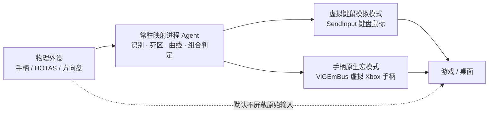
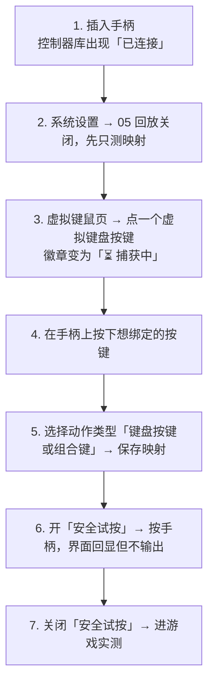
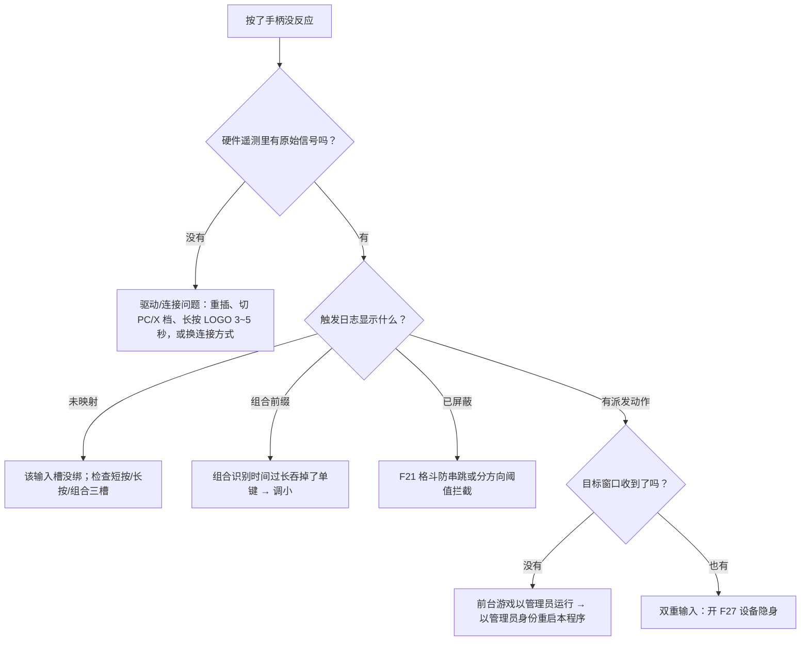

# GamePad Studio 使用手册

> 本手册面向 **Windows 10 / 11（64 位）正式版**用户，按「有哪些功能 → 每项功能怎么用」的顺序组织。
> 界面文字取自程序实际使用的中文标签，用「」标注；英文界面下对应标签见 [附录 C](#附录-c-界面语言与术语)。
> macOS 14+ 目前为适配预览，差异见本手册 [第 6.4 节](#macos-用户注意) 与 [docs/MACOS_SUPPORT.md](MACOS_SUPPORT.md)。

---

## 目录

- [第 1 部分 功能总览](#第-1-部分-功能总览)
- [第 2 部分 十分钟跑通第一条映射](#第-2-部分-十分钟跑通第一条映射)
- [第 3 部分 逐功能使用方法](#第-3-部分-逐功能使用方法)
  - [3.1 设备与预设](#31-设备与预设)
  - [3.2 按键映射](#32-按键映射)
  - [3.3 操作手感](#33-操作手感)
  - [3.4 隐身与共存](#34-隐身与共存)
  - [3.5 截图录制与反馈](#35-截图录制与反馈)
  - [3.6 协作与维护](#36-协作与维护)
- [第 4 部分 场景配方](#第-4-部分-场景配方)
- [第 5 部分 故障排查](#第-5-部分-故障排查)
- [第 6 部分 能力边界](#第-6-部分-能力边界)
- [附录](#附录-a-全局快捷键与界面操作)

---

# 第 1 部分 功能总览

## 1.1 界面地图

程序主窗口左侧是导航栏，分为三组：

| 分组 | 页面 | 用途一句话 |
| :--- | :--- | :--- |
| 工作空间 | **设备概览** | 当前手柄的状态、电量、预设选择与快捷入口 |
| 工作空间 | **按键配置** | 手柄输出预设：把按键映射成「另一个手柄按键」「组合宏」「连招宏」 |
| 工作空间 | **虚拟键鼠** | 键鼠输出预设：ANSI 87 虚拟键盘 + 鼠标工作台，把按键映射成键盘/鼠标动作 |
| 设备与内容 | **控制器库** | 已发现的外设列表、型号识别、收藏、切换映射目标 |
| 设备与内容 | **截图图库** | 已保存的截图与回放片段 |
| 设备与内容 | **硬件遥测** | 原始输入实时观测、活动记录、导出诊断 |
| 底部 | **系统设置** | 截图、回放、触觉、隐身、服务、快捷键等全局项 |
| 底部 | **使用指南** | 应用内速查提示（本手册的浓缩版） |

顶部状态胶囊（从窗口右上角开始）依次是：**连接状态徽章 → 「暂停手柄映射」 → 「即时截屏」 → 窗口最小化/最大化/关闭**。
底部状态栏显示「映射运行中 / 映射已暂停」与提示「F11 切换全屏 · Esc 返回窗口」。

## 1.2 两层输出：先理解这个，再用后面的功能

GamePad Studio 的输入端可以是任何手柄、飞行摇杆、方向盘；输出端有两条完全不同的通路。**每个预设只属于其中一条**，「设备概览」页顶部的模式徽章会显示当前生效预设属于哪条：

- **虚拟键鼠模拟模式**：输出键盘按键、鼠标移动与点击。绝大多数只支持键鼠的游戏用它；连发（Turbo）也用它。
- **手柄原生宏模式**：输出标准 XInput 手柄报告，用于「游戏已经支持手柄，但你想要一键连招 / 一键组合 / 游戏内高频连发」。它需要系统里装有 **ViGEmBus 驱动**，见 [F11](#f11-手柄输出模式与虚拟-xinput-总线)。

## 1.3 功能清单

编号在 [第 3 部分](#第-3-部分-逐功能使用方法) 逐项展开。

| 编号 | 功能 | 入口 |
| :-- | :--- | :--- |
| **设备与预设** | | |
| F01 | 外设连接与型号识别 | 控制器库 · 「重新扫描设备」 |
| F02 | 选择映射目标手柄 | 控制器库 · 「切换到此手柄」/「管理」 |
| F03 | 按设备隔离的配置与预设 | 设备概览 · 「配置预设」 |
| F04 | 新建 / 删除 / 恢复默认预设 | 按键配置 · 虚拟键鼠 工具栏 |
| **按键映射** | | |
| F05 | 点击式虚拟键鼠绑定（ANSI 87） | 虚拟键鼠 |
| F06 | 键位详细列表批量编辑 | 虚拟键鼠 · 「详细列表」 |
| F07 | 短按 / 长按 / 组合键三类输入 | 绑定页 |
| F08 | 按住语义：按住生效 · 按一次保持 · Turbo · 双击并按住 | 绑定页 · 「触发方式」 |
| F09 | 手柄动作宏（连招序列） | 按键配置 · 动作类型「手柄动作宏 (连招序列)」 |
| F10 | 手柄多键组合宏（一键出招） | 按键配置 · 动作类型「手柄多键组合宏」 |
| F11 | 手柄输出模式与虚拟 XInput 总线 | 按键配置 |
| F12 | 可绑定的动作类型全集 | 绑定页 · 动作类型下拉 |
| F13 | 触摸板手势映射（10 种） | 「触摸板」/ 系统设置 · 「手势映射 ›」 |
| F14 | 安全试按 | 虚拟键鼠 · 输入选项「安全试按」 |
| F15 | 交换两个输入的绑定 | 「详细列表」/ 当前按键 · 「交换」 |
| F16 | 触发日志 | 按键配置页 · 折叠面板「触发日志」 |
| F17 | 识别按键（自动进入录入） | 按键配置 · 「识别按键」 |
| **操作手感** | | |
| F18 | 视角与指针：用途 / 控制摇杆 / 垂直方向 / 居中容错 | 「操作手感」 |
| F19 | 300 Hz 弹簧-阻尼镜头与边缘增强 | 随 F18 生效，无需单独配置 |
| F20 | 陀螺仪体感瞄准 | 「操作手感」→「陀螺仪体感瞄准」 |
| F21 | 扳机/摇杆行程响应、分方向推满阈值、格斗防串跳、组合识别时间 | 「操作手感」→「按键响应」 |
| F22 | 轻推慢走 | 「操作手感」→ 慢走 |
| F23 | 扳机输入曲线与振动强度曲线 | 「曲线」/ 系统设置 · 「编辑曲线」 |
| F24 | 右摇杆静止测量（漂移补偿） | 系统设置 ·「静止测量」 |
| F25 | 常用玩法一键套用（4 个模板） | 「更多设置」→「常用玩法一键套用」 |
| F26 | 操作布局（《无限暖暖》专属视图） | 虚拟键鼠 · 「操作布局」 |
| **隐身与共存** | | |
| F27 | HidHide 设备隐身 | 设备概览 →「设备隐身」行 →「配置」 |
| F28 | 屏蔽 Game Bar 与系统弹窗 | 系统设置 ·「屏蔽 Windows 截图与 Game Bar 弹窗」 |
| F29 | 紧急暂停（物理键盘全局热键） | 系统设置 ·「紧急暂停」 |
| F30 | 暂停映射、后台服务、托盘、开机启动 | 状态胶囊 · 系统设置「系统服务与开机启动」 |
| **截图、录制与反馈** | | |
| F31 | 即时截屏与捕获范围 | 「即时截屏」· 系统设置 ·「捕获目标屏幕与范围」 |
| F32 | 截图存储路径与防抖冷却 | 系统设置 ·「截图存储路径」 |
| F33 | 4K 内存回放缓存与保存 | 系统设置 ·「4K 极清回放缓存」 |
| F34 | 截图图库 | 截图图库 |
| F35 | 触觉与音效反馈（快门声 / 掌心脉冲 / 振动强度） | 系统设置 ·「硬件交互与反馈」 |
| F36 | LED 状态光条 | 系统设置 ·「LED 状态光条」 |
| **协作与维护** | | |
| F37 | 应用关联：进游戏自动切预设 | 「更多设置」→「应用关联」 |
| F38 | 预设导入 / 导出 | 「更多设置」→「导入预设」/「导出此预设」 |
| F39 | 硬件遥测原始输入观测 | 硬件遥测 |
| F40 | 活动记录与导出诊断 | 硬件遥测 |
| F41 | 低电量提醒 | 系统设置 ·「低电量提醒」 |
| F42 | 界面语言、全屏、窗口 | 系统设置 ·「界面语言 / Language」 |

---

# 第 2 部分 十分钟跑通第一条映射

前置条件检查：

1. 解压后直接双击 `GamePadStudio.exe`，无需安装、不改注册表。
2. 手柄已被识别（Xbox / DualSense / DualShock 4 / Switch Pro / 北通、八位堂、飞智等免驱手柄，或任何 DirectInput 外设）。
3. 若目标游戏**以管理员身份运行**，本程序必须以管理员身份运行，否则 Windows UIPI 会拦截键鼠模拟（症状见 [第 5 部分](#第-5-部分-故障排查)）。

---

# 第 3 部分 逐功能使用方法

## 3.1 设备与预设

### F01 外设连接与型号识别

**入口**：控制器库；设备概览。

1. 接入手柄（USB / 蓝牙均可）。程序每 1 秒扫描一次，通常无需干预。
2. 没有自动出现时，点控制器库顶部「**重新扫描设备**」。
3. 型号识别结果直接显示在卡片标题上。识别采用三层：内置 VID/PID 表 → 离线缓存的 SDL_GameControllerDB 与 usb.ids → 回退为通用 XInput。显示「**未识别，尝试 XInput 模式**」时按通用 XInput 布局映射仍可用，但型号专属键（如 DualSense 的触摸板、Create/Share）可能不出现。
4. DirectInput 杂牌手柄会自动做 A/B 型按键归一化，无需手动对调。

**收藏**：卡片上的星标（`controller_favorites`）只影响列表排布，不影响映射。

### F02 选择映射目标手柄

**入口**：控制器库。

- 当前卡片显示「**管理**」= 它就是正在被映射的设备；其他设备显示「**切换到此手柄**」。
- 切换时程序会**释放所有已按住的按键**，避免游戏里卡键。
- 一次只为「所选手柄」执行映射；其他手柄保持原生行为。

### F03 按设备隔离的配置与预设

配置分两层，界面上只出现当前设备支持的选项：

| 层 | 内容 | 跟随 |
| :--- | :--- | :--- |
| 设备设置 | 死区、长按阈值、振动强度、曲线、LED、触摸板开关 | 当前设备 |
| 映射预设 | 每个按键的短按/长按/组合绑定 | 当前设备的预设列表 |

没连接手柄时使用通用 XInput 公共配置。完整规则见 [DEVICE_BOUND_SETTINGS.md](DEVICE_BOUND_SETTINGS.md)。

### F04 新建 / 删除 / 恢复默认预设

- **新建**：按键配置页「**新建手柄配置**」（建手柄输出预设）；虚拟键鼠页「**新建预设**」（建键鼠预设）。新预设从当前预设复制，避免从零开始。
- **删除**：按键配置页「**删除**」。当前设备至少保留一个预设，删到最后一个时弹「无法删除配置」并建议改用「恢复默认配置」或「另存为新预设」；删除前会二次确认「删除后不可恢复」。
- **恢复默认**：「**更多设置**」→「恢复默认」，只重置**当前预设**，不动其他预设和设备设置。
- **设为当前生效**：绑定改动后，点工具栏「**设为当前生效**」（徽章为「✓ 已加载生效」时说明后台已载入）。「设为手动预设」用于覆盖应用关联的自动匹配，见 [F37](#f37-应用关联进游戏自动切预设)。

## 3.2 按键映射

### F05 点击式虚拟键鼠绑定（ANSI 87）

**入口**：虚拟键鼠。

1. 页面上半部是标准 87 键键盘与鼠标图。鼠标悬停任意键显示提示：
   - 已绑定：显示「【键名】当前绑定 …」与「💡 点击配置/修改 · 右键快速清除绑定」；
   - 未绑定：显示「未绑定外设触发 · 💡 点击开始捕获手柄/外设按键」。
2. **左键点击**一个虚拟按键 → 该键进入「**⏳ 捕获中**」，提示变为「请在手柄、飞行摇杆或任意接入设备上按下按键或推轴」。
3. 在手柄上按下要绑定的按键（或推动轴/扳机）。识别到后立即打开绑定页。
4. 绑定页里确认动作类型（默认「键盘按键或组合键」），需要时选「触发方式」，点「**保存映射**」。
5. **右键点击**虚拟按键 = 快速清除该键的所有绑定，不弹确认。

> 0~63 号按键直通：飞行摇杆、方向盘的按钮即使没有官方名称，也会以 `Button n` 形式被捕获并可绑定。

### F06 键位详细列表批量编辑

**入口**：虚拟键鼠 ·「**详细列表**」。

列表按输入来源逐行显示短按/长按/组合与输出结果，行尾「**编辑**」打开同一绑定页。适合核对整套布局、逐行修补缺口，以及使用 [F15 交换](#f15-交换两个输入的绑定)。

### F07 短按 / 长按 / 组合键三类输入

同一个物理按键最多提供三个互不干扰的输入槽：

| 输入 | 触发条件 | 说明 |
| :--- | :--- | :--- |
| **短按 (SHORT PRESS)** | 按下即触发 | 最常用 |
| **长按 (LONG PRESS)** | 按住超过阈值才触发 | 默认阈值 0.65 秒；绑定页内「长按识别阈值」可按此键单独覆盖，全局值在系统设置「长按手势识别阈值」 |
| **组合** | 同时按住两个以上按键成为一个新输入 | 「组合按键（至少两个）」；保存后**回到一级页为这个组合再设短按或长按动作** |

组合至少需要两个不同按键，否则保存时提示「组合至少需要两个不同的按键」。组合的判定余量由「组合识别时间」控制（默认 0.055 秒，见 [F21](#f21-扳机摇杆行程响应分方向推满阈值格斗防串跳组合识别时间)）。

### F08 按住语义：触发方式

**入口**：绑定页 ·「触发方式」（仅在键盘/鼠标按住类动作中出现）。

| 选项 | 行为 |
| :--- | :--- |
| **按住时生效** | 传统按住，松开即失效 |
| **按一次保持，再按一次取消** | 切换保持。同一来源再次触发会释放；**暂停映射、手柄断线、切换预设、进入安全试按、退出程序**也会释放 |
| **按住高频连发 (Turbo)** | 按住期间按设定频率连发，5–30 Hz |
| **双击并按住 (冲刺/奔跑)** | 双击后进入按住状态，用于奔跑/冲刺 |

「按一次保持」模式**不提供**给触摸板一次性手势和 CapsLock 等系统锁定键。

### F09 手柄动作宏（连招序列）

**入口**：按键配置 → 选中一个输入 → 动作类型「**手柄动作宏 (连招序列)**」。

这是「按顺序按出多个手柄按键」的连招，与「一键同时按下多键」的 [F10 组合宏](#f10-手柄多键组合宏一键出招) 不同。

1. 未录制时提示「🎯 目标手柄宏: 未录制 · 点击上方按键添加连招步骤」。
2. **点击上方按键网格，每点一次追加一个有序步骤**，在摘要行下方排成一行。
3. 需要间隔时点「**+ 延迟**」插入一段延迟；延迟芯片可点击修改时长，可单独删除。
4. 删除某个按键步骤：**直接点击该芯片**（悬停变红即为删除提示）。
5. 统一设置每步按住时长：调「**每步按住**」数字框，会写入所有步骤。
6. 可选两个开关：
   - 「**可打断**」：其他手柄动作被触发的瞬间，先停止并释放正在执行的宏，两个执行器不会抢同一个按键位；
   - 「**连续（按住循环）**」：按住不放时反复执行整段，松开即停。
7. 摘要行实时显示「🎯 目标手柄宏: N 步 · 约 X ms · 可打断 · 循环」，点「保存映射」。

限制：宏步骤 1–64；每步按住 10–500 ms；步间隔 0–5000 ms；目标只能是手柄按键。超限时提示「宏最多 %d 步」；空宏保存时提示「宏流程为空：请先点击上方按键录制至少一个步骤」。

**生命周期反馈**：宏的执行结果记录在专门的事件通道里，措辞形如「宏完成 · 3 步 · 0.24s」「宏循环 4 轮后松手停止 · 0.70s」「宏被打断 · 停在第 1/3 步 · 已释放 LB」。在 [F16 触发日志](#f16-触发日志) 与 [F40 活动记录](#f40-活动记录与导出诊断) 中查看。

### F10 手柄多键组合宏（一键出招）

**入口**：按键配置 → 动作类型「**手柄多键组合宏 (一键出招)**」。
点击多个按键 → 摘要显示「🎯 目标手柄组合宏: A + B + X (一键同时触发)」→ 保存。按下时这些键**同时**处于按下状态，松开同时释放。适合「同时按下冲刺+跳跃」这类真正的组合。

### F11 手柄输出模式与虚拟 XInput 总线

**手柄输出模式**（按键配置页）让映射结果作为**标准 Xbox 手柄报告**送给游戏。它用于两类需求：

- 游戏只认手柄、不认模拟键鼠输入；
- 游戏内高频连发需要走手柄位，而不是键盘位。

要求与检查：

1. 系统需安装 **ViGEmBus 驱动**（Nefarius ViGEm Bus Driver）。程序内不提供驱动安装入口，请自行下载安装后**重启本程序**。
2. 程序自带用户态客户端库 `ViGEmClient.dll`，正常无需处理。
3. 后端可用时，绑定页顶部显示「手柄输出配置；已检测到虚拟手柄后端（ViGEmBus / VirtualHID），实时合成标准 XInput 报告。」
4. 后端不可用时，连发选项旁显示「**未接入虚拟手柄驱动；游戏内连发请改用虚拟键鼠模式的"按住高频连发 (Turbo)"**」，此时请改用键鼠预设。

> 新出现的虚拟手柄在某些系统上会短暂占据 XInput 用户索引（实测 19–90 ms）。若游戏在启动瞬间枚举手柄，请以游戏内实际可见为准。

### F12 可绑定的动作类型全集

绑定页的「动作类型」下拉包含（键鼠模式）：

| 动作类型 | 结果 |
| :--- | :--- |
| 键盘按键或组合键 | 模拟键盘，可填 `Ctrl+Alt+X` 形式 |
| 鼠标单击 | 左/右/中键单击（含按住、双击按住等触发方式） |
| 鼠标滚轮滚动 | 上/下滚动，触摸滚动可设为「每格触发一次」 |
| 保存截图 | 按系统设置的捕获范围存 PNG |
| 保存精彩瞬间 | 导出回放缓存里的过去片段为 MP4 |
| 开始或结束录屏 | Windows 上转交系统录制（Win+Alt+R）；开启 F28 屏蔽后提示改用回放保存 |
| 打开控制中心 | 呼出 Windows 游戏栏/控制中心类系统面板 |
| 打开截图资料库 | 跳到截图图库页 |
| 启动应用程序 | 启动指定程序 |
| 未设置 | 清空该输入槽 |

手柄输出模式下，动作类型为手柄按键、组合宏、连招宏及上述系统动作。

### F13 触摸板手势映射（10 种）

**入口**：虚拟键鼠 · 输入选项「**触摸板**」；或设备概览「手势映射 ›」；或系统设置 ·「触摸板手势」。仅对**真实上报触摸输入**的设备出现（DualSense、DualShock 4 等）。

1. 对话框开关：「**手势识别**」、单指鼠标、双指滚动回退。
2. 「**识别灵敏度**」滑杆 0–1（默认 0.5）；文案提示「较高灵敏度需要更短的滑动距离」。
3. 下半部为手势列表：轻触、双击、按住、四向滑动（上/下/左/右）、双指轻触、双指滚动上、双指滚动下 —— 共 **10 种可作为映射来源**。
4. 用一只手做动作，「**最近识别：…**」实时预览；确认无误后点「**绑定此手势**」。预览区明确标注「预览只显示结果，不执行动作」。
5. 也可以在普通绑定页里点「**录入手柄按键或触摸手势**」，做一遍手势完成录入。

细节：

- 双指手势只在设备上报 ≥2 点容量时出现；DualSense / DS4 默认按 2 点，其他设备按 1 点隐藏。
- 「单指鼠标」与「未绑定方向的直接滚动」有各自独立开关；触摸板**实体按下**仍是独立按键，可单独映射。
- 固定时序：轻触 ≤250 ms、双击 280 ms、按住 550 ms、滑动 ≤750 ms。
- 设置按设备保存，动作按该设备的映射预设保存。详见 [CONTROLLER_TOUCH_GESTURES.md](CONTROLLER_TOUCH_GESTURES.md)。

### F14 安全试按

**入口**：虚拟键鼠 · 输入选项「**安全试按**」。

开启后：**窗口获得焦点期间**，映射只回显、不向系统注入任何键鼠输入。用来验证「按这个键走的是哪条绑定」，不会真的打字或移动鼠标。触发日志中这些条目会带「安全试按」前缀与琥珀色 ⚠ 标记。
试按期间进入「按一次保持」的绑定会被释放。确认无误后关闭它再进游戏。

### F15 交换两个输入的绑定

**入口**：「详细列表」行内或「当前按键」的「**交换**」。

一次互换**两个输入**的完整短按、长按与识别时长。确认前会显示双方「当前」与「交换后」的结果；期间设备、绑定或时长发生变化会让旧预览失效，需要重新打开。

规则：触摸手势之间可互换，持续按键之间可互换，**两类来源不能混合互换**。其他绑定、手感参数与当前生效预设保持不变。

### F16 触发日志

**入口**：按键配置页下方折叠面板「**触发日志**」（默认折叠，保留最近 200 条）。

它区分四类结论：

| 记录形式 | 含义 |
| :--- | :--- |
| `A 短按 → 手柄连招 (3 步)` | 已派发动作 |
| `RB 按下 · 未映射` | 裸按，没绑定 |
| `LB 按下 · 组合前缀` | 被当作组合前缀等待第二个键 |
| `· 已屏蔽` | 被规则抑制（如格斗防串跳） |

「**仅动作**」勾选后只显示已派发条目（隐藏但不丢弃历史）。安全试按期间的条目带 ⚠。用于回答「我按了没反应，到底是没识别、还是被抑制了」。

### F17 识别按键

**入口**：按键配置 ·「**识别按键**」。
点击后程序打开一张新的绑定页并直接进入捕获态，你在手柄上按的任意按键 / 推动的任意轴会成为这条绑定的触发源。适合不想在示意图上找小按键的场合（摇杆、肩部轴尤其有用）。捕获时必须先松开按键，否则按钮显示「先松开按键并抬起手指，再输入按键或手势」。

## 3.3 操作手感

### F18 视角与指针

**入口**：虚拟键鼠 · 输入选项「**操作手感**」→「视角与指针」。

| 项 | 选项 | 说明 |
| :--- | :--- | :--- |
| **用途** | 游戏视角 / 桌面指针 | 决定摇杆输出的是相对镜头移动还是系统鼠标指针 |
| **控制摇杆** | 右摇杆 (默认) / 左摇杆 | 没有左摇杆的设备该项不出现 |
| **垂直视角方向** | 常规 / 反转 | **只反转游戏镜头**；桌面指针始终常规方向 |
| **居中容错** | 死区滑杆 | 文案「居中容错越大，越不容易因摇杆漂移而转动视角」，默认 0.10 |

设置按当前设备预设保存，也随 [F38](#f38-预设导入--导出) 便携文件导入导出。

### F19 300 Hz 弹簧-阻尼镜头与边缘增强

这是「用途 = 游戏视角」时的内置行为，不需要单独开关：摇杆位移经二阶弹簧-质量-阻尼模型平滑，接近屏幕边缘时做无感边界守护。默认指针参数为死区 0.06、灵敏度 28、纵向比例 0.70、边缘增强 1.70。你能调的是 F18 的死区、F20 的体感灵敏度与鼠标模式/灵敏度。

### F20 陀螺仪体感瞄准

**入口**：「操作手感」→「**陀螺仪体感瞄准**」。

1. 打开「**启用体感瞄准**」。
2. 「**激活方式**」：按住 L2/LT · 按住 R2/RT · 按住 L1/LB · 按住 R1/RB · 常驻开启。
3. 「**体感灵敏度**」1–100（默认 18）。
4. 「**Y 轴反转**」常规 / 反转。

设备必须真的上报陀螺仪。支持一键套用见 [F25](#f25-常用玩法一键套用4-个模板) 的「射击体感」模板。

### F21 扳机/摇杆行程响应、分方向推满阈值、格斗防串跳、组合识别时间

**入口**：「操作手感」→「**按键响应**」。

| 项 | 用法 |
| :--- | :--- |
| 开始响应 / 松开位置 | 数字扳机与轴的按下/释放行程点。校验规则：**松开位置必须低于开始响应**（滞回，防止边缘反复触发） |
| **分方向独立推满阈值** | 打开「分方向独立推满阈值」后，上/下/左/右可各自设定推到底的判定值，用于横版与 3D 混合布局 |
| **格斗防串跳**（`LS:up` 误触抑制） | 「正常响应 (默认)」/「搓招防误跳 (横推/斜推时不轻易跳起)」/「禁用摇杆向上 (Hitbox/独立跳跃键流派)」。用于格斗游戏前下后（236/214）划过上半区时误跳 |
| **组合识别时间** | 「给同时按下的两个按键留一点余量；时间越短，单键响应越快」，默认 0.055 秒 |

### F22 轻推慢走

**入口**：「操作手感」→ 慢走 ·「**轻推慢走**」。

前提：先把「左摇杆轻推」映射为 **Ctrl**，否则该项显示「先将"左摇杆轻推"映射为 Ctrl，即可启用轻推慢走。」
启用后：轻推区间按住 Ctrl（慢走），推深后恢复正常跑；冲刺仍由独立按键控制。
校验规则：摇杆开始响应 < 回到慢走 < 转为正常跑，不满足时保存报错「慢走区间需满足：摇杆开始响应 < 回到慢走 < 转为正常跑。」

### F23 扳机输入曲线与振动强度曲线

**入口**：虚拟键鼠 · 输入选项「**曲线**」；手柄映射页点击 L2/R2（Xbox 的 LT/RT、Switch 的 ZL/ZR）；或系统设置 ·「双马达振动强度」行的「**编辑曲线**」。菜单只显示当前设备真实支持的通道。

三类编辑器：

1. **扳机输入曲线**（左/右）：改变扳机按下量到输出量的映射。
2. **双马达振动曲线**（低频/高频）：改变振动幅度响应。
3. **扳机振动曲线**（左/右）：独立扳机马达，需设备能力检测，默认关闭，开关文案「应用反馈使用扳机振动」。

操作方式：曲线上有 5 个控制点，0% 与 100% 端点固定，中间 3 点可拖动，强制单调；每通道另有「死区」「饱和度」0–100（互相限制）；预设「线性 / 灵敏 / 精准」一键载入。想先听效果，选通道、调「测试力度」（默认 0.55）后点「**预览此通道**」——它会短振 250 ms 然后恢复已保存曲线，文案明确「短振动预览当前草稿，不会保存设置。」最后用「应用」或「保存」落盘，「重置」回默认。

两点必须知道：

- 曲线改变的是**幅度/输出量，不是扳机的物理阻尼手感**；
- 数字扳机设备不显示连续曲线，系统设置里会提示「**未检测到线性扳机（数字按键模式）**」并建议「长按 LOGO 键 3~5 秒或切换背部拨档至 PC/X 档」。

曲线按当前设备保存，只影响本软件的映射与反馈。依据见 [CONTROLLER_CURVES.md](CONTROLLER_CURVES.md)。

### F24 右摇杆静止测量（漂移补偿）

**入口**：系统设置 ·「硬件遥测」区 →「右摇杆」→「**静止测量**」。

1. 松开摇杆、手柄平放，点「**开始测量**」。
2. 流程：0.75 秒稳定 + 3 秒采样，至少 60 个样本。期间**移动摇杆、数据停更 >0.15 秒、断线或换设备都会让测量作废**，此时点「重新测量」。
3. 结果形如「测量完成 · 偏移 x% · 波动 y%」并给出「建议居中容错 N%」（= 峰值 + 2%，限定在 3%–20%）。
4. 偏移或波动过大时**不给建议**：「静止偏移过大，暂不建议调整死区」/「摇杆波动较大…」——这种摇杆该修硬件，软件补偿无意义。
5. 测量本身**不写配置**。要生效：选择该手柄的一个**键鼠预设**并应用，只会改那个预设的右摇杆容错，其他手感与绑定保持不变。

这是软件补偿，不修改手柄固件。

### F25 常用玩法一键套用（4 个模板）

**入口**：「**更多设置**」→「**常用玩法一键套用**」。每个模板只改相关参数，保留其余绑定。

| 模板 | 适合 | 做了什么 |
| :--- | :--- | :--- |
| 横版动作：摇杆推底双击奔跑 (DNF) | DNF 等横版 | 推到底 + 双击组合触发奔跑 |
| 3D 动作：左摇杆推底双击 W 冲刺 | 3D 动作游戏 | 推到底双击 W |
| 射击体感：按住左扳机开启陀螺仪瞄准 | FPS/TPS | 启用体感，激活方式 = 按住 L2/LT |
| 左手鼠标：切换左摇杆控制鼠标指针 | 桌面/策略 | 控制摇杆改为左摇杆，用途为指针 |

### F26 操作布局（《无限暖暖》专属视图）

**入口**：虚拟键鼠 · 输入选项「**操作布局**」，标题「无限暖暖 · 操作布局」。
按「基础行动 / 探索 / 能力 / 菜单」分组列出当前预设的真实键位，行尾「编辑」直达绑定页。文案提醒「以游戏内键位和已解锁槽位为准」。
完整布局、阈值与依据见 [INFINITY_NIKKI_LAYOUT.md](INFINITY_NIKKI_LAYOUT.md)。

## 3.4 隐身与共存

### F27 HidHide 设备隐身

**默认不隐身**：映射工作时不屏蔽原始输入，游戏仍会直接读到手柄 —— 这正是「双重输入」与 UI 图标狂闪的来源。

**入口**：设备概览 ·「**设备隐身**」行 → 开关直接生效，点「**配置**」打开完整面板。

**全程不需要打开 HidHide 自己的界面**。白名单（应用程序）、黑名单（设备）和总开关都由本程序直接读写驱动；配置读写不需要管理员权限，只有首次安装驱动那一次需要提权。

| 页签 | 作用 |
| --- | --- |
| 应用程序 | 允许哪些程序继续看到被隐藏的手柄。本程序自己始终在列表里（锁定，不可删）；其他程序写入的条目原样保留 |
| 设备 | 按设备分组，可展开查看每个 HID 集合。勾选整行会一次隐藏该设备的**全部**节点，包含 XInput 通道。名称后会标出来源：`本程序创建`、`虚拟手柄 · ViGEmBus`、`虚拟设备 · VHF`；物理设备不标 |
| 驱动与状态 | 驱动版本、服务状态、总开关、反向模式、本程序登记的条目数量 |

**来源标记怎么读**：徽标依据是设备在系统设备树里的祖先节点（注册表 `Service` / `HardwareID`，与显示语言无关），鼠标悬停会写出判定依据，例如 `Service=ViGEmBus @ ROOT\SYSTEM\0001`。`本程序创建` 只标由本程序此刻拉起的那颗虚拟手柄 —— 判定方式是创建前后的设备差集，因此其他工具（DS4Windows、reWASD、Handheld Companion 等）用同一个驱动造出的手柄会被标成 `虚拟手柄 · ViGEmBus` 而不会被冒认成本程序的。虚拟设备与物理设备一样可以勾选隐藏：隐藏自己创建的虚拟手柄，等于把本程序的输出从游戏里摘掉，这属于有意的实验手段，程序不会拦你。

**开关语义**与 HidHide 界面一致：设备勾选与总开关相互独立。只勾选而不打开总开关，其他程序仍能访问；面板会把这一点写在开关下方。

**驱动未安装 / 未运行**：面板顶部出现「**一键安装驱动**」或「**修复：启动驱动**」。安装使用随包发布的官方 HidHide 安装包（校验 SHA-256 后以管理员权限静默执行），完成后通常需要重启系统。这是内核驱动唯一一次提权。

**被其他程序占用**：HidHide 的配置设备同一时刻只允许一个客户端。若 HidHide 配置界面、Handheld Companion、DS4Windows 等正在使用，本面板转为只读并写出疑似占用者名字；关掉对方后点「**刷新**」。本程序不做抢占重试。

**出问题**：

- 面板底部「**一键恢复所有共享访问**」清空隐藏列表并关闭总开关；
- 程序无法启动时，用命令行 `GamePadStudio.exe --uncloak-all` 解除全部屏蔽；
- 隐身开启后游戏**失去原生手柄读取**，原生震动、自适应扳机、HD 触觉等表现由本程序的输出替代，不保证等价。

设置是系统级且持久保存（重启后仍在）：本程序退出时只解除**由它自己添加**的隐藏，不动其他工具的条目。Apple Boot Camp 环境拒绝安装该驱动，以免内置键盘/触控板失灵。

### F28 屏蔽 Game Bar 与系统弹窗

**入口**：系统设置 ·「截图服务与存储」→「**屏蔽 Windows 截图与 Game Bar 弹窗**」。

作用：关闭 Windows 对游戏栏与手柄录制键的响应，避免按 Share/PS 键弹系统面板、抢焦点。启用时写入 5 项 HKCU 值并广播设置变更，原值备份在配置文件里，关闭时恢复；同时结束本会话已确认的游戏栏宿主进程。

失败提示与处理：

- 「写入注册表失败 (N 项未成功)，请检查权限」→ 换用有权限的账户或退出后重试；
- 「系统设置已保存，但游戏栏未能关闭；请关闭游戏栏后重试」→ 手动结束游戏栏后再切一次。

开启后，「开始或结束录屏」这类系统录制动作会被拒绝并提示「系统录制已屏蔽，可使用后台回放保存录像」——这是设计行为，请用 [F33](#f33-4k-内存回放缓存与保存)。

### F29 紧急暂停

**入口**：系统设置 ·「系统服务与开机启动」→「紧急暂停」→「**设置快捷键**」。

1. 功能**默认关闭**。建议 `Ctrl+Alt+F10`。
2. 校验规则：至少包含 Ctrl/Alt/Shift 中的两个，再加一个普通键；Win、Meta、F12、PrintScreen 被保留，不能作为组合。
3. 后台注册成功后，**游戏前台**也能一键暂停本程序的键鼠映射，并且会**释放所有按住的键**；状态会被保留。
4. **恢复必须回到工作台手动操作**（顶部「暂停手柄映射」）。这是有意的：紧急情况下不允许游戏内误触恢复。
5. 被其他程序占用同一组合、或后台离线时，界面明确显示「未生效」，不会假装成功。完全退出时注销。

它依赖后台进程与 Windows 桌面消息，不是系统级安全开关。

### F30 暂停映射、后台服务、托盘、开机启动

| 操作 | 位置 | 行为 |
| :--- | :--- | :--- |
| 暂停 / 恢复映射 | 顶部状态胶囊「暂停手柄映射」 | 立即释放按住键；底部状态栏显示「映射已暂停 / 映射运行中」 |
| 常驻映射监听进程 (Agent) | 系统设置 ·「停止服务」/「启动服务」 | 后台负责 1 ms 级按键拦截；状态行显示在线情况 |
| 关闭窗口 | 右上「关闭窗口」 | 工作台界面退出，**映射由常驻 Agent 继续执行**，不受影响；要停止映射用「暂停映射」或 F29。界面常驻系统托盘，菜单为「打开工作台」「退出」，双击托盘图标重新打开工作台 |
| 系统开机自动启动 | 系统设置 ·「系统开机自动启动」 | 登录后后台启动当前配置的映射服务，默认关闭 |

## 3.5 截图、录制与反馈

### F31 即时截屏与捕获范围

三种触发方式：

1. 顶部状态胶囊「**即时截屏**」按钮；
2. 把动作类型「保存截图」绑到任意手柄按键（**推荐**，手柄直达）；
3. 手柄原生 Share / Create / Capture 键的默认行为：PS 系 Create/Share 截图，Xbox 独立 Share 截图（无 Share 键时保留原键可自定义），Switch 优先 Capture（否则用 −）。

**捕获范围**（系统设置 ·「捕获目标屏幕与范围」）：

| 选项 | 内容 |
| :--- | :--- |
| 🎮 智能游戏屏幕 (自动探测锁定) | 自动锁定前台游戏所在屏 |
| 🖥️ 双屏全景全录制 (全部显示器) | 跨屏合成；**刷新率不同或未知时禁用该项** |
| 🖥️ 显示器 1 / 2 | 单屏 |
| 🪟 智能目标窗口（前台优先） | 只抓前台窗口 |

产物为 `DS_<游戏名>_<时间戳>_<4 位十六进制>.png`，游戏名与捕获元数据写进 PNG 的 `tEXt` 块，**不生成额外 sidecar 文件**。
HDR 屏幕会自动转换为标准颜色；转换失败时静默回退到系统截图，画质会降级但不会失败。

> **Windows 没有全局物理键盘截图热键**。「物理键盘截图快捷键」这一行只在 macOS 出现。Windows 侧请用工具栏按钮、手柄绑定或系统自带 `Win+Shift+S`。

### F32 截图存储路径与防抖冷却

- 系统设置 ·「截图存储路径」→「**更改目录...**」。回放片段也存到这里。
- 「**防抖冷却间隔**」0.10–2.00 秒（默认 0.1 秒），文案「连击防误触时间阈值」。绑定了 Turbo 或放在易误触位置时适当调大。

### F33 4K 内存回放缓存与保存

**入口**：系统设置 ·「4K 极清回放缓存」。

1. 打开「**4K 极清回放缓存**」（默认关闭）。缓存是 **100% 纯内存的环形缓冲区，零磁盘写入**，不启用就不占资源。
2. 「**录制屏幕**」单独选择（与截图范围互不影响）。HDR 自动转标准颜色；不同刷新率的屏幕需分别录制。
3. 「**最大回看时间 (纯内存滑动窗口)**」1–10 分钟（默认 5）。**内存占用 ≈ 分钟 × 60 × 码率(Mbps) ÷ 8 MB**（另有约 3 秒关键帧前置余量），5 分钟 / 50 Mbps 约 1.9 GB，请按机器内存预算。
4. 「**硬件编码器与画质方案**」：HEVC 标杆极清（推荐 · 50 Mbps）/ AV1 次世代极清（AMF/NVENC · 45 Mbps）/ H.264 兼容模式（60 Mbps）。程序按 AMF → NVENC → QSV → Media Foundation → libx265 顺序探测，结果在状态 HUD 中显示。
5. 保存片段：把动作类型「**保存精彩瞬间**」绑到长按/双击键，或直接点「**立即保存当前回放**」。导出的是**过去**的内容。

导出细节与坑：

- 保存用无损流拷贝封装 MP4，不重编码，文件名为 `DS_<title>_<时间戳>_replay.mp4`，并生成同名 `.jpg` 缩略图与 `.json` 元数据。
- 两次保存之间有 2 秒冷却。
- 缓存还没积够时会提示「**回放内存缓冲区尚在初始化积蓄，请稍后再试**」——启用后等几秒再试。
- 录制期间**改变显示器布局、刷新率或 HDR 状态会中止录制**，提示「显示器布局、刷新率或 HDR 状态已改变，请重新开启录制」。旋转屏幕不支持。
- 编码器依赖 FFmpeg 组件（程序目录 `bin/ffmpeg.exe` → PATH → 已知目录 → 随包组件）。全部找不到时提示「未检测到可用 FFmpeg 组件」，此时回放与录制不可用，映射不受影响。

「开始或结束录屏」动作：Windows 上它转交系统录制（Win+Alt+R）；开启 [F28](#f28-屏蔽-game-bar-与系统弹窗) 后会被拒绝并引导使用回放缓存。

时长与颜色语义见 [RECORDING_COLOR_AND_TIMING.md](RECORDING_COLOR_AND_TIMING.md)。

### F34 截图图库

**入口**：截图图库。列表每 5 秒自动刷新，显示截图与回放片段缩略图；「设备概览」的「近期截图」区做快速回看。双击条目打开系统默认程序。

### F35 触觉与音效反馈

**入口**：系统设置 ·「硬件交互与反馈」。

| 项 | 说明 |
| :--- | :--- |
| 机械快门音效反馈 | 截图成功时播放合成的高保真快门声（首次使用时生成 `assets/shutter.wav`）；播放失败静默 |
| 掌心触觉脉冲反馈 | 截图成功瞬间 60 ms 两段式轻触 |
| 双马达振动强度 | 0–100%（默认 35%），配「**脉冲测试**」试听 |
| 应用触觉反馈 | 「快门触觉」「冲击脉冲」「心跳律动」三种模式试听 |

设备不支援震动时试听按钮提示「此设备暂时无法预览振动。」
独立扳机马达需能力检测且默认关闭，开关见 [F23](#f23-扳机输入曲线与振动强度曲线)。

### F36 LED 状态光条

**入口**：系统设置 ·「LED 状态光条」→ 选择「手柄呼吸光条发光色调」：经典蓝（默认 #5686ff）、纯白、关闭灯光、活力橙、霓虹紫、荧光绿、战意红、暖阳金。「恢复默认」恢复 DualSense 默认经典蓝。仅对上报 LED 能力的设备生效。

## 3.6 协作与维护

### F37 应用关联：进游戏自动切预设

**入口**：「**更多设置**」→「**应用关联**」。

1. 打开「**自动切换预设**」（默认关闭）。
2. 「**添加应用...**」→ 选择**游戏实际运行的 `.exe`**（不做名称猜测，按完整路径匹配）。
3. 每行的「**使用预设**」下拉选择该手柄的一个键鼠预设（每个 exe 对应一个预设），「**移除**」删除该规则。
4. 「**保存**」。

行为与例外（很重要）：

- 进入该应用时自动生效，离开后恢复原手动预设；
- **编辑映射期间和「安全试按」期间保持当前预设**，不被自动切换打断；
- **暂停映射不会恢复输出**；
- 临时覆盖：重新选择当前预设，或用「**设为手动预设**」——覆盖只在本次前台应用变化前有效；
- 规则只能引用**当前设备自己**的预设，也只作用于当前设备；前台每 0.25 秒轮询一次；
- 权限不足时安全回退，不会误切。

### F38 预设导入 / 导出

**入口**：「**更多设置**」→「**导出此预设**」/「**导入预设**」。**两个方向都要求已连接手柄**。

- 导出：便携文件 `<预设名>.gpsprofile.json`，含当前预设的绑定与操作手感。**不含**设备身份、应用路径、系统设置、启动命令。
- 导入：确认前先列出「可用」与「跳过」的绑定及原因（「当前设备不支持此输入」/「型号专属按键不能跨手柄类型导入」）。确认后**总是创建当前设备的新预设**，重名自动改名，**绝不覆盖**现有预设，当前生效预设保持不变。
- 跨品牌沿用按键的物理位置；型号专属键与缺失输入整组跳过。原始 DirectInput 外设（摇杆、方向盘）只能在**相同型号同族**设备上导入。
- 文件格式、大小（≤256 KiB）、条目数（≤512 绑定）与参数都要通过校验，不合规文件会被拒绝。

### F39 硬件遥测

**入口**：硬件遥测。显示 SDL **原始**轴值与按键/POV/摇杆轨迹，明确标注「**不应用软件死区**」——这是用来判断「硬件到底有没有发出信号」的，不是用来对手感的。

用法：怀疑某个键没反应时，先在这里确认有没有原始信号。有信号但没动作 → 查 [F16 触发日志](#f16-触发日志) 的「未映射 / 组合前缀 / 已屏蔽」；这里也没信号 → 设备或驱动问题。

### F40 活动记录与导出诊断

- 「**活动记录**」打开事件日志视图，包含派发结果、宏生命周期、以及权限类警告。例如前台游戏以管理员运行时会出现：「检测到前台程序（xxx.exe）以管理员权限运行，Windows UIPI 会拦截普通权限的键鼠模拟；请以管理员身份运行 GamePad Studio。」
- 「**导出诊断**」→ 选择保存位置后生成 `GamePadStudio-diagnostic-<时间戳>.json`。内容只有平台、设备能力摘要、服务在线状态与映射/录制开关、以及最近活动的**脱敏类别计数**；不含原始日志、按键轨迹、设备身份、个人路径或预设。适合发给我们排查「连不上、没输出、录制失败」。

### F41 低电量提醒

**入口**：系统设置 ·「低电量提醒」（默认关闭，按设备保存）。

仅对真实上报电量的设备出现。持续低电量或极低电量时**各提醒一次**（界面提示 + 托盘通知），掉到极低再提醒；回到中等以上或接入外接供电后重新计数。未知电量与外接供电不会误报，也不估算百分比。
最小化到托盘仍会提醒；完全退出程序后不再提醒。是否弹出还取决于 Windows 自身的通知设置。

### F42 界面语言、全屏与窗口

- 系统设置 ·「界面语言 / Language」：中英文即时切换，个别项需重启。
- **F11** 切换全屏（默认全屏启动），**Esc** 返回窗口；缩小窗口后导航与内容分组自动重排（ROG Ally一类的掌机屏宽下会自动收拢）。
- 配置文件位置：`%LOCALAPPDATA%\GamePadStudio\studio.json`（旧目录 `DualSenseStudio` 自动迁移），事件日志在同目录。

---

# 第 4 部分 场景配方

## 4.1 只支持键鼠的老游戏：手柄当鼠标键盘用

1. 键鼠预设 → F05 绑定移动 WASD、跳跃、交互、技能 1–6。
2. 「操作手感」→ 用途 = 游戏视角，控制摇杆 = 右摇杆，调居中容错。
3. 若游戏**同时**仍认到你的物理手柄（镜头转两下、UI 闪）→ 开 F27 设备隐身。
4. 长按 = 按住类技能用 F08「按住时生效」；需要自动连发用「按住高频连发 (Turbo)」。

## 4.2 原生支持手柄的游戏：只想要连招

1. 「按键配置」新建**手柄输出**预设。
2. 需要自动执行的组合用 F09「手柄动作宏 (连招序列)」，格斗/连打建议勾「可打断」；需要按住循环输出的勾「连续（按住循环）」。
3. 一键同时按的用 F10 组合宏。
4. 确认已装 ViGEmBus（F11）；没装则连发改走键鼠预设。
5. 用 F16 触发日志核对「宏完成 / 宏被打断 / 宏循环 N 轮后松手停止」。

## 4.3 横版动作（DNF 类）双击奔跑

1. 「更多设置」→「常用玩法一键套用」→「横版动作：摇杆推底双击奔跑 (DNF)」。
2. 按 F21 打开「分方向独立推满阈值」，把「向前」推满阈值调到不触发跳跃为止。
3. 格斗类误跳：F21「格斗防串跳」= 搓招防误跳，或改 Hitbox 流派用「禁用摇杆向上」+ 独立跳跃键。

## 4.4 射击：扳机瞄准 + 体感微调

1. F25 →「射击体感：按住左扳机开启陀螺仪瞄准」。
2. 「体感灵敏度」从默认 18 起，每次 +5 试；准星抖就降。
3. RT 绑鼠标左键并把触发方式设为「按住时生效」；LT 作为体感激活键，不要同时绑成别的动作。
4. F23 调右扳机输入曲线，把「开始响应」调浅以减少击发行程。

## 4.5 掌机（ROG Ally 类）手持游玩《无限暖暖》一类的游戏

1. 先用「操作布局」（F26）核对键位与游戏内设置是否一致。
2. 触摸手势按 F13 全部开启，单指鼠标与直接滚动先关闭，识别灵敏度 40%。
3. 目标设备是 WeGame 版游戏时注意：游戏有原生手柄支持 → 优先手柄输出预设（F11）；只认键鼠 → 键鼠预设 + F28 屏蔽 Game Bar，防止误触系统面板抢焦点。
4. 摇杆漂移 → F24 静止测量并按建议应用容错。

---

# 第 5 部分 故障排查

| 症状 | 先查 | 处理 |
| :--- | :--- | :--- |
| 镜头/指针一开播就自己转 | F39 原始轴值 | 摇杆漂移；F24 测量后应用建议容错 |
| 游戏里同一个动作触发两次、UI 图标闪烁 | 是否开了隐身 | 开 F27；注意会失去原生手柄功能 |
| 按 Share/PS 键弹出系统面板 | F28 | 启用「屏蔽 Windows 截图与 Game Bar 弹窗」 |
| 回放按钮点了没反应 | HUD 编码器状态 | 「缓冲区尚在初始化积蓄」→ 等几秒；「未检测到可用 FFmpeg 组件」→ 补 `bin/ffmpeg.exe` |
| 按一次保持的键一直不松 | 是否处于安全试按/暂停 | 退出安全试按、恢复映射、或再按一次同一来源 |
| 游戏内连发不生效 | 是否绑在**手柄输出**预设上 | 装 ViGEmBus，或改用键鼠预设的 Turbo |
| 型号专属键（触摸板/Create）找不到 | F01 是否识别为未识别 | 换官方连接模式/固件模式；未识别时按通用 XInput 布局映射 |
| 双指手势不出现 | 设备能力 | 该设备上报的单点容量，双指项按设计隐藏 |
| 切了预设没效果 | 徽章是否「✓ 已加载生效」 | 点「设为当前生效」；或后台离线，看 F40 活动记录 |
| 想立刻停下所有模拟输入 | — | 「暂停手柄映射」或 F29 紧急暂停热键（需预先启用） |

**把自己锁在外面的兜底**：手柄全部隐身、无法操作本程序时，命令行运行 `GamePadStudio.exe --uncloak-all` 解除所有屏蔽。

---

# 第 6 部分 能力边界

手册不承诺这些事，避免误判为 bug：

1. **不注入、不改内存**，因此不接管游戏原生触觉：游戏自己的 DualSense HD 触觉、自适应扳机阻力不会因为我们映射而出现；隐身开启后更是完全由本程序的输出替代。
2. **曲线改变幅度，不改变物理阻力**。扳机手感变「重」只能通过曲线让输出量延迟上升，弹簧张力不变。
3. **F24 是软件补偿**，不改固件，不修复硬件磨损。
4. **Windows 无物理键盘全局截图热键**（仅 macOS 提供）。
5. **不宣称完整音频触觉波形**：快门声是合成的 WAV 通过系统播放，不是 DualSense 专用音频波形；内置组件里的 DualSense 麦克风相关实现是探针用途，不是面向用户的功能。
6. **多屏限制**：刷新率不同或未知时禁止「全部屏幕」；HDR 跨屏录制不支持；旋转屏不支持。
7. **应用关联按完整路径匹配**，不猜游戏名；绿色版换目录后需重新添加。
8. **预设文件不带设备身份**，不能用来「克隆设备配置」。
9. **紧急暂停不会自动恢复**，必须回工作台。
10. 内置的语音助手/实验联动入口默认关闭，不在本手册覆盖范围内。

## macOS 用户注意

macOS 14+ 为源码运行与 `.app` 适配预览：键鼠用原生键鼠、截图/多屏捕获用系统 API。差异集中在：需要「辅助功能」与「屏幕录制」权限（在系统设置页有一键授权入口）、设备隐身走原生 HID 独占、全局热键与登录启动、VirtualHID 代替 ViGEmBus、物理键盘截图热键可用、开始/结束录屏保存完整本地 MP4。系统音轨与特殊键、真实虚拟手柄仍有明确缺口。逐项差异见 [MACOS_PARITY.md](MACOS_PARITY.md) 与 [MACOS_SUPPORT.md](MACOS_SUPPORT.md)。

---

# 附录 A 全局快捷键与界面操作

| 键 / 操作 | 作用 |
| :--- | :--- |
| **F11** | 切换全屏 / 窗口 |
| **Esc** | 返回窗口（也用于退出当前捕获态） |
| 双击托盘图标 | 打开工作台 |
| 虚拟按键 左键 | 进入捕获并开始绑定 |
| 虚拟按键 右键 | 快速清除该键绑定 |
| 宏步骤芯片 点击 | 删除该步骤 |
| 手柄 Share / Create / Capture | 默认截图（可改绑） |
| `Ctrl+Alt+F10`（建议） | 紧急暂停，需在系统设置中启用 |
| `GamePadStudio.exe --uncloak-all` | 解除全部 HidHide 屏蔽 |

# 附录 B 配置文件与产物位置

| 内容 | 路径 |
| :--- | :--- |
| 主配置 | `%LOCALAPPDATA%\GamePadStudio\studio.json` |
| 事件日志 / Agent 日志 | 同目录 `events.jsonl`、`agent-events.jsonl` |
| 截图与回放输出 | 系统设置「截图存储路径」指定目录 |
| 预设导出文件 | 自选目录，`<名称>.gpsprofile.json` |
| 诊断导出 | 自选目录，`GamePadStudio-diagnostic-<时间戳>.json` |
| 快门音效资源 | 程序目录 `assets/shutter.wav`（首次使用生成） |
| FFmpeg | 程序目录 `bin\ffmpeg.exe` 或 PATH |
| 旧配置迁移 | 旧目录 `DualSenseStudio` 自动迁移 |

# 附录 C 界面语言与术语

| 术语 | 含义 |
| :--- | :--- |
| 预设 / 方案 | 一组绑定；分「手柄输出预设」（按键配置页）与「键鼠预设」（虚拟键鼠页） |
| 手柄原生宏模式 | 当前生效预设输出 XInput 手柄报告 |
| 虚拟键鼠模拟模式 | 当前生效预设输出键盘鼠标事件 |
| 短按 / 长按 / 组合 | 同一个物理输入的三张动作卡 |
| 组合前缀 | 已按下、正在等待第二个键组成组合的按键 |
| 居中容错 | 摇杆死区（`pointer_deadzone`） |
| 安全试按 | 只回显、不注入的预览状态 |
| 设备隐身 | HidHide 屏蔽物理手柄 |
| 常驻映射监听进程 (Agent) | 后台 1 ms 级拦截与派发服务 |
| 精彩瞬间 / 回放 | 内存环形缓存中「过去 N 分钟」的片段 |

---

*手册对应 GamePad Studio 2.2.x 分支界面。若你的界面与本手册不一致，请以程序内实际标签为准，并提交 [Issue](https://github.com/lilymoonight/GamePadStudio/issues) 指出偏差。*
